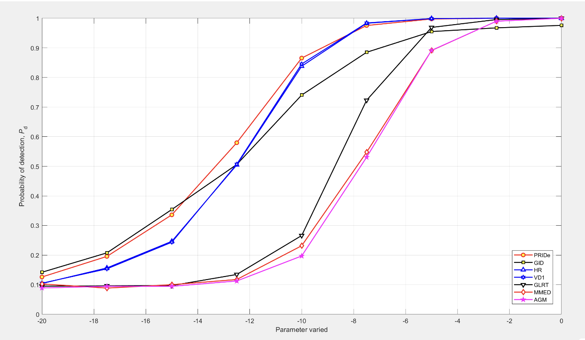
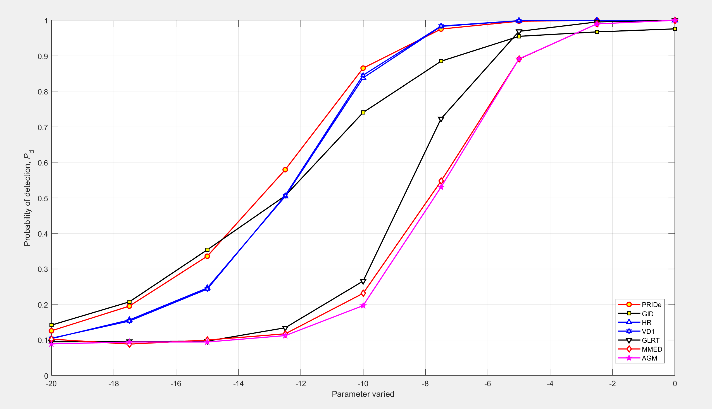

# Simulation of several data fusion collaborative spectrum sensing technologies in cognitive radio applications (Matlab code implementation)

Research on Performance of Several Data Fusion Collaborative Spectrum Sensing Technologies in Cognitive Radio Applications (Matlab Code Implementation)
\n        \n  
​​  

## Images

<!-- PAYMENT_BLOCK -->

## Get this dataset

- Payment link (Stripe): [Buy now](https://buy.stripe.com/3cs8yP7sY87d0vu9AB)
- Payment QR code: 

<!-- /PAYMENT_BLOCK -->
